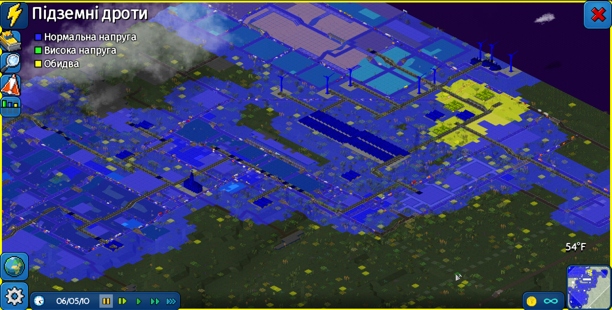

# Просторовий ШІ (Spatial AI) та цифрові двійники (Digital Twins) для проєктування децентралізованих мікромереж (Smart Grid) аграрних територій

**Статус:** Робочий MVP (`v0.3`)  
**Стек:** Python 3 (стандартна бібліотека `math`), TheoTown (Digital Twin)  
**Контекст:** Проєкт ІІІ лабораторії (AI Innovation & Research Studio) АДШІ, підготовка до конкурсу «Ідеї майбутнього - 2027»

---

## Про проєкт

Розподільчі електромережі сільських та аграрних громад України історично побудовані за радіальною схемою з протяжними повітряними ЛЕП від застарілих магістральних підстанцій. За умов воєнних ризиків і погодних аварій пошкодження навіть однієї ділянки лінії призводить до повного знеструмлення громади: лікарень, водоочисних споруд, фермерських комплексів і житлового сектору.

Цей проєкт реалізує концепцію **«доступного цифрового двійника»** - зв'язку легковагової просторової симуляції та відкритого алгоритму оптимізації на Python, що працює на звичайному бюджетному ПК без дорогих ліцензій. Програмний модуль виконує роль ШІ-асистента проєктувальника (4-й рівень автономності): ранжує споживачів за критичністю, контролює баланс потужності та підбирає найближче локальне джерело генерації з мінімальною довжиною підземних кабельних трас.

> **Примітка щодо безпеки даних:** з міркувань інформаційної безпеки під час воєнного стану в проєкті принципово не використовуються точні координати, реальні схеми чи телеметрія чинних об'єктів енергетики України. Усі розрахунки й моделювання виконано на синтетичній узагальненій моделі умовної аграрної громади **«Світлоярівка»**.

---

## Цифровий двійник «Світлоярівка» («До» та «Після»)

Модель створено в середовищі **TheoTown** (із використанням користувацьких плагінів, тому вихідні файли збережень `.city` зберігаються у локальному архіві проєкту, а для демонстрації без встановлення гри наведено порівняльні панорами нижче).

### Стан «До»: вразлива радіальна повітряна ЛЕП
Стрес-тест (імітація обриву єдиної магістральної лінії від старої підстанції) призводить до повного знеструмлення громади.


### Стан «Після»: децентралізована Smart Grid
Зовнішню повітряну магістраль демонтовано, розміщено локальну генерацію (кластер вітрогенераторів біля аграрної зони, масив СЕС і накопичувачі біля житла й критичної інфраструктури, біогазову станцію біля ферми) та прокладено захищені підземні кабелі.


### Верифікація «острівного режиму» (технічний шар «Підземні дроти»)
Інспекція підземних комунікацій підтверджує суцільне **100% покриття** електропостачанням без залежності від зовнішньої ЛЕП.



---

## Результати роботи алгоритму (`v0.3`)

Контрольний прогін скрипту `smart_grid_optimizer.py` на 3 укрупнених кластерах споживачів (сумарно `370 кВт`) і 3 кластерах локальної генерації (`500 кВт`):

| Пріоритет | Споживач | Потреба | Підібране джерело генерації | Довжина траси | Залишок потужності |
| :---: | :--- | :---: | :--- | :---: | :---: |
| **1** | Лікарня та Водоканал | 50 кВт | Центральна СЕС + Акумулятори (100 кВт) | 3.61 м | 50 кВт |
| **2** | Фермерський комплекс | 120 кВт | Біогазова станція (150 кВт) | 3.61 м | 30 кВт |
| **3** | Житловий сектор | 200 кВт | Розподілені СЕС на дахах (250 кВт) | 7.07 м | 50 кВт |

**Ключові метрики прототипу:**
- Покриття електропостачанням в «острівному режимі»: **100%**
- Забезпечення живленням об'єктів 1-го пріоритету: **100%** (50 із 50 кВт)
- Сумарна розрахункова довжина підземних трас: **14.28 умовних м**
- Резерв встановленої потужності мікромережі: **130 кВт (26%)**

---

## Структура репозиторію

- `smart_grid_optimizer.py` - базовий програмний модуль просторової оптимізації (Python 3).
- [Паспорт проєкту АДШІ (PDF)](<Паспорт проєкту АДШІ - Клєвцов-Ковтеба Д. В..pdf>) - повна документація всіх 10 модулів дослідження.
- `Світлоярівка_26-11-14_16.01.43.png` - панорама цифрового двійника у стані «До».
- `Світлоярівка_ПІСЛЯ_26-11-14_16.04.32.png` - панорама модернізованої мікромережі у стані «Після».
- `Світлоярівка_підземні_проводи.jpg` - технічний шар підземної мережі в «острівному режимі».

---

## Як запустити скрипт

Скрипт не потребує встановлення сторонніх бібліотек - достатньо стандартного **Python 3**.

```bash
python smart_grid_optimizer.py
```

---

## Обмеження поточної версії та план розвитку (`v0.4`)

Поточна реалізація є робочим MVP для етапу передпроєктного моделювання і використовує спрощену евклідову метрику (відстань по прямій) та статичний баланс активної потужності. Результати мають передпроєктний характер і не замінюють сертифікованих розрахунків згідно з ПУЕ.

**Заплановано в ітерації `v0.4`:**
1. Реалізація сценарію аварійного дефіциту генерації (гарантоване збереження живлення вузлів 1-го пріоритету з коректним попередженням про розвантаження менш критичних споживачів).
2. Перехід від евклідової відстані до графової моделі прокладання кабелів уздовж вулиць (алгоритми Дейкстри / A*).
3. Додавання базового розрахунку перерізу кабелю, втрат напруги та орієнтовного бюджету (CAPEX).
4. Автоматична візуалізація схеми підключень.

---

## Автор

**Клєвцов-Ковтеба Даніїл Валентинович**  
Студент ВСП «КФК ПІТБ ДДМА» (спеціальність 141 / G3 «Електроенергетика, електротехніка та електромеханіка», спеціальність 121 «Інженерія програмного забезпечення»), учасник ІІІ лабораторії (AI Innovation & Research Studio) АДШІ.
