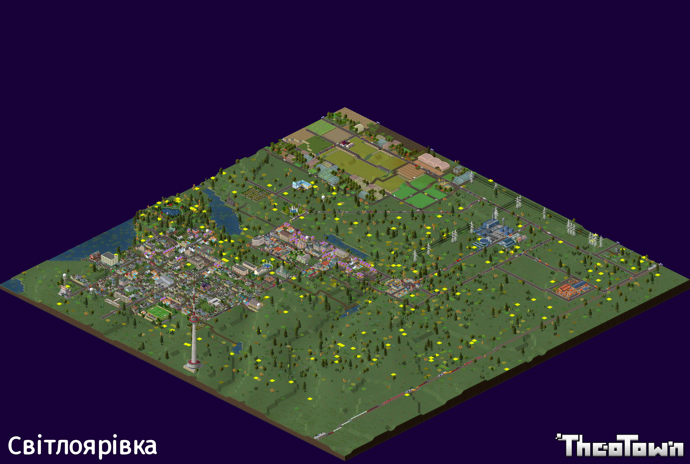
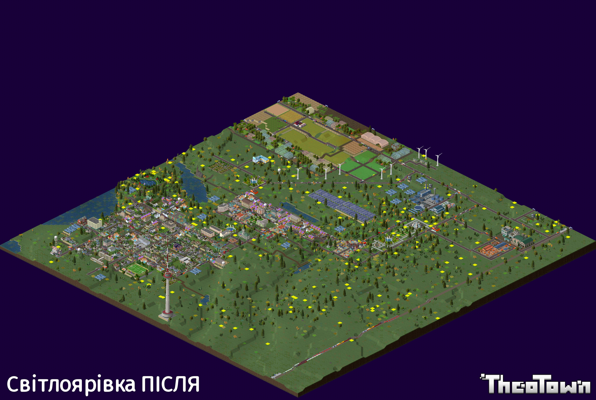
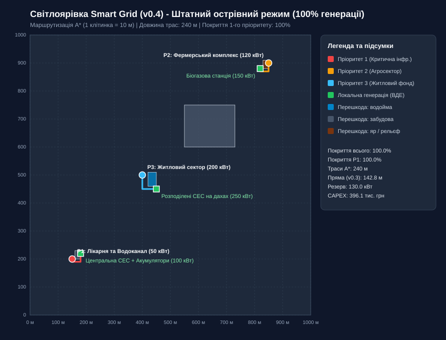
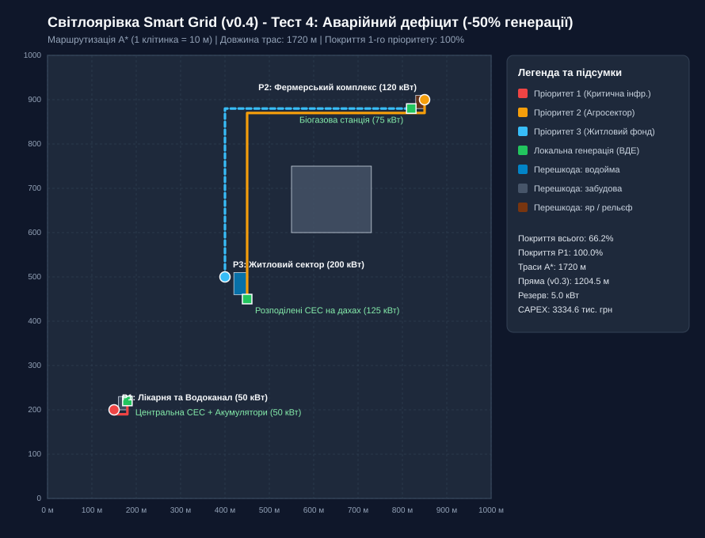

# Просторовий ШІ (Spatial AI) та цифрові двійники (Digital Twins) для проєктування децентралізованих мікромереж (Smart Grid) аграрних територій

**Статус:** Робочий прототип (`v0.4`)  
**Стек:** Python 3 (стандартна бібліотека: `heapq`, `math`, `copy`, `pathlib`), TheoTown (Digital Twin), SVG  
**Контекст:** Проєкт ІІІ лабораторії (AI Innovation & Research Studio) АДШІ, підготовка до конкурсу «Ідеї майбутнього - 2027»

---

## Про проєкт

Розподільчі електромережі сільських та аграрних громад України історично побудовані за радіальною схемою з протяжними повітряними ЛЕП від застарілих магістральних підстанцій. За умов воєнних ризиків і погодних аварій пошкодження навіть однієї ділянки лінії призводить до повного знеструмлення громади: лікарень, водоочисних споруд, фермерських комплексів і житлового сектору.

Цей проєкт реалізує концепцію **«доступного цифрового двійника»** - зв'язку легковагової просторової симуляції та відкритого алгоритму оптимізації на Python, що працює на звичайному бюджетному ПК без дорогих ліцензій і сторонніх бібліотек. Програмний модуль виконує роль ШІ-асистента проєктувальника (4-й рівень автономності): ранжує споживачів за критичністю, прокладає підземні кабелі алгоритмом **A\*** в обхід перешкод, підбирає переріз кабелю АВБбШв 0.4 кВ за ПУЕ з перевіркою втрат напруги, оцінює CAPEX та автоматично генерує векторні схеми підключень.

> **Примітка щодо безпеки даних:** з міркувань інформаційної безпеки під час воєнного стану в проєкті принципово не використовуються точні координати, реальні схеми чи телеметрія чинних об'єктів енергетики України. Усі розрахунки й моделювання виконано на синтетичній узагальненій моделі умовної аграрної громади **«Світлоярівка»**.

---

## Цифровий двійник «Світлоярівка» («До» та «Після»)

Модель створено в середовищі **TheoTown** (із використанням користувацьких плагінів, тому вихідні файли збережень `.city` зберігаються у локальному архіві проєкту, а для демонстрації без встановлення гри наведено порівняльні панорами нижче).

### Стан «До»: вразлива радіальна повітряна ЛЕП
Стрес-тест (імітація обриву єдиної магістральної лінії від старої підстанції) призводить до повного знеструмлення громади.



### Стан «Після»: децентралізована Smart Grid
Зовнішню повітряну магістраль демонтовано, розміщено локальну генерацію (кластер вітрогенераторів біля аграрної зони, масив СЕС і накопичувачі біля житла й критичної інфраструктури, біогазову станцію біля ферми) та прокладено захищені підземні кабелі.



### Верифікація «острівного режиму» (технічний шар «Підземні дроти»)
Інспекція підземних комунікацій підтверджує суцільне **100% покриття** електропостачанням без залежності від зовнішньої ЛЕП.


---

## Результати роботи алгоритму (`v0.4`, A\* + ПУЕ + CAPEX)

У версії `v0.4` координатну сітку прив'язано до реалістичного масштабу (`1 клітинка = 10 м`, мапа `1 x 1 км`) із перешкодами (ставок, забудова, яр).

### Сценарій 1: Штатний «острівний режим» (100% генерації, 500 кВт)

| Пріоритет | Споживач | Потреба | Джерело генерації | Довжина A\* (пряма) | Підібраний кабель (0.4 кВ) | Струм / Втрати dU | Оцінка CAPEX |
| :---: | :--- | :---: | :--- | :---: | :--- | :---: | :---: |
| **1** | Лікарня та Водоканал | 50 кВт | Центральна СЕС + Акумулятори | 70 м (36.1 м) | АВБбШв 4x25 | 80.2 А / 2.63% | 71 050 грн |
| **2** | Фермерський комплекс | 120 кВт | Біогазова станція | 70 м (36.1 м) | АВБбШв 4x95 | 192.5 А / 1.81% | 98 000 грн |
| **3** | Житловий сектор | 200 кВт | Розподілені СЕС на дахах | 100 м (70.7 м) | АВБбШв 4x240 | 320.8 А / 2.00% | 227 000 грн |

* **Покриття навантаження:** 370 із 370 кВт (**100%**), резерв потужності **130 кВт (26%)**
* **Сумарна довжина підземних трас (A\*):** **240 м** (проти 142.8 м по прямій у `v0.3`)
* **Орієнтовний CAPEX кабельних ліній:** **396 050 грн**



### Сценарій 2 (Тест 4): Аварійний дефіцит (-50% генерації, 250 кВт)

| Пріоритет | Споживач | Потреба | Статус живлення | Джерело генерації | Довжина A\* | Кабель / Втрати dU |
| :---: | :--- | :---: | :--- | :--- | :---: | :---: |
| **1** | Лікарня та Водоканал | 50 кВт | **Заживлено (100%)** | Центральна СЕС + Акумулятори | 70 м | АВБбШв 4x25 / 2.63% |
| **2** | Фермерський комплекс | 120 кВт | **Заживлено (100%)** | Розподілені СЕС на дахах | 850 м | 2x(АВБбШв 4x120) / 8.96% |
| **3** | Житловий сектор | 200 кВт | Частково (**37.5%**, 75 кВт) | Біогазова станція | 800 м | АВБбШв 4x150 / 8.72% |

* **Покриття критичних об'єктів (1-й пріоритет):** **100%** (50 із 50 кВт)
* **Загальне покриття в аварійному режимі:** **66.2%** (245 із 370 кВт), сформовано автоматичне попередження про розвантаження житлового сектору на 125 кВт та контроль аварійного ліміту напруги (до 10% за ДСТУ EN 50160).



---

## Структура репозиторію

- `smart_grid_optimizer.py` - програмний модуль просторової оптимізації `v0.4` (A\*, дефіцит, ПУЕ, CAPEX, SVG).
- `svitloyarivka_grid_normal.svg` - автоматично згенерована векторна схема підключень (штатний режим).
- `svitloyarivka_grid_deficit.svg` - автоматично згенерована векторна схема підключень (Тест 4, дефіцит -50%).
- [Паспорт проєкту АДШІ (PDF)](<Паспорт проєкту АДШІ - Клєвцов-Ковтеба Д. В..pdf>) - повна документація всіх 10 модулів дослідження.
- `Світлоярівка_26-11-14_16.01.43.png` - панорама цифрового двійника у стані «До».
- `Світлоярівка_ПІСЛЯ_26-11-14_16.04.32.png` - панорама модернізованої мікромережі у стані «Після».
- `Світлоярівка_підземні_проводи.jpg` - технічний шар підземної мережі в «острівному режимі».

---

## Як запустити скрипт

Скрипт не потребує встановлення сторонніх бібліотек - достатньо стандартного **Python 3**.

```bash
py smart_grid_optimizer.py
```

*(Або `python smart_grid_optimizer.py` / `python3 smart_grid_optimizer.py` залежно від ОС.)*

---

## Автор

**Клєвцов-Ковтеба Даніїл Валентинович**  
Студент ВСП «КФК ПІТБ ДДМА» (спеціальність 141 / G3 «Електроенергетика, електротехніка та електромеханіка», спеціальність 121 «Інженерія програмного забезпечення»), учасник ІІІ лабораторії (AI Innovation & Research Studio) АДШІ.
